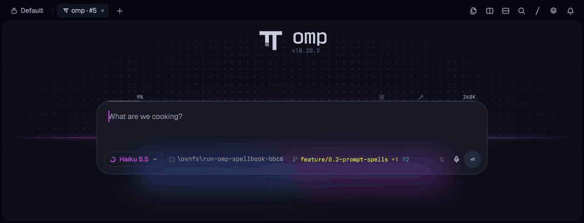

# Spellbook

Forget the flags, keep the words. Spellbook is an [omp](https://omp.sh) plugin: type `?` and what you want in
plain words, and the shell command morphs into the composer as `!<command>`. You read it, edit it if you like, and
press Enter. Nothing runs until you do.



- `? <description>` → `!<command>` (runs in your shell, output goes to the model's context, as omp's `!` does)
- `?? <description>` → `!!<command>` (output kept out of the model's context)
- A line under the composer says in plain words what the command does, with a **⚠ Destructive** warning when it
  deletes, overwrites, force-pushes or stops something.
- Every command you send after a `?` is saved in your **spellbook** under your own words. Next time, type `?` and a
  few of those words and press **Tab**: pick the saved command, no model call.

Works on Windows, Linux and macOS, with stock omp 18.20.2 or later, in any terminal; in [Tern](https://tern.sh) the
morph is drawn in colour.

## Install

You need omp 18.20.2 or later and `git` on your PATH.

**Windows** (PowerShell, cmd or Git Bash):

```sh
omp plugin install github:Dazzuh/omp-spellbook
```

Install [Git for Windows](https://git-scm.com/download/win) if you don't have it: omp's `!` commands run in its Git
Bash, so Spellbook writes Bash commands with Windows paths in mind. Without Git Bash, omp still runs `!` lines with
its built-in POSIX shell, and Spellbook sticks to programs Windows has (`where`, `findstr`, `powershell -Command`).

**Linux and macOS**:

```sh
omp plugin install github:Dazzuh/omp-spellbook
```

Commands are written for the shell omp's `!` uses: your `$SHELL` when it is bash, zsh or fish, else bash or sh.

Restart omp (or open a new session) and run `/spellbook` to see what it picked: style, spellbook file, model and
shell.

To try it without installing: `omp -e /path/to/omp-spellbook`. To remove it: `omp plugin uninstall omp-spellbook`.

## Choosing the model

Spellbook asks a small, fast model. It uses omp's model roles, like the rest of omp:

1. the `spellbook` role, when you set one;
2. else the `smol` role;
3. else the model the session runs on.

Give Spellbook its own model in your omp `config.yml`:

```yaml
modelRoles:
  spellbook: anthropic/claude-haiku-5-5
```

Any model you are logged in to works (`/login`, or the provider's API key in the environment).

### What the model sees

Only a small packet, never your conversation: the description, the working folder, the OS, the shell `!` runs in
(plus notes such as "Git Bash: coreutils available"), your SSH host aliases from `~/.ssh/config` (names only), your
last few `!` commands in this session, and up to four saved spells with similar words. The whole request stays under
4 KB.

## Settings

Change them with `/spellbook`, or edit `<omp agent dir>/spellbook/settings.json` (`~/.omp/agent/spellbook/settings.json`
by default):

| Setting | Values | Default | `/spellbook` command |
| --- | --- | --- | --- |
| `style` | `diff`, `decode`, `rewind`, `none` | `diff` | `/spellbook style decode` |
| `bookPath` | a path; `~` is your home folder, a relative path sits beside `settings.json` | `book.json` | `/spellbook book ~/notes/spellbook.json` |
| `recentCommands` | how many recent `!` commands to send, 0 to 20 | `5` | edit the file |

The environment variables `SPELLBOOK_STYLE` and `SPELLBOOK_BOOK` override the file.

### Morph styles

- **`diff`** (default): letters both texts share stay put; the rest of your words turn red and dissolve while the
  command's letters grow in, green as they arrive.
- **`decode`**: scrambled glyphs sweep left to right and settle into the command.
- **`rewind`**: your words erase backwards, then the command types itself out.
- **`none`**: the command just appears.

Motion turns off by itself when omp's **Motion** setting (`tui.motion`) is `reduced` or `none`, or when Tern's Reduce
Motion is on. Colour shows in Tern and in terminals omp draws in ANSI; when another extension has replaced omp's
composer, Spellbook plays the morph as plain text.

## The spellbook file

A plain JSON file you can read, edit, copy between machines or keep in your dotfiles:

```json
{
	"version": 1,
	"spells": [
		{ "words": "show the last 10 commits, one line each", "command": "git log -10 --oneline", "uses": 3, "lastUsed": "2026-11-15T17:20:33.530Z" }
	]
}
```

The command saved is the one you actually sent, edits included. If the file stops being valid JSON, Spellbook warns
you and leaves it alone rather than overwrite your edits.

`/spellbook list [words]` shows saved spells; `/spellbook cast <description>` is the same as typing `? <description>`
(and prints the answer as JSON when omp runs headless, `omp -p`).

## Development

```sh
bun install
bun test                      # unit tests
bun run typecheck
SPELLBOOK_LIVE=1 bun test test/live.test.ts   # real model through stock omp; runs the commands in your ! shell
```

The live test starts omp with `bunx @oh-my-pi/pi-coding-agent@18.20.2` unless `SPELLBOOK_OMP` names another command,
and uses `anthropic/claude-haiku-5-5` unless `SPELLBOOK_MODEL` says otherwise. CI runs the unit tests, a load check in
stock omp and a GitHub install on Windows, Linux and macOS; the live test runs there when the repository has an
`ANTHROPIC_API_KEY` secret.

## Licence

MIT
